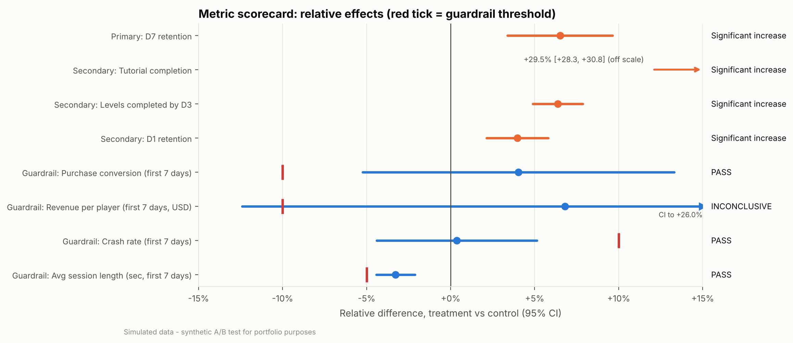

# Mobile Game Onboarding A/B Test: End-to-End Experiment Analysis

> ⚠️ **Synthetic data.** Every player, event and result in this repo is **simulated** (`src/simulate.py`) for portfolio purposes.
> The game is fictional. The workflow is the real part: pre-registration → SQL cohorts → statistical analysis → readout.

**Question:** should a free-to-play puzzle game replace its 7-step forced tutorial with a 3-step "learn by playing" onboarding?

## Key result

<!-- BEGIN:headline (generated by `python -m src.report`) -->
**SHIP WITH MITIGATION (staged rollout + follow-up fix experiment).** The short onboarding lifted **D7 retention from 17.81% to 18.97% (+1.16pp, 95% CI +0.62pp to +1.70pp; p < 0.0001)**, about **1,160 extra retained players per 100k installs**. Tutorial completion rose +17.63pp.
Every guardrail passed except first-week revenue, which is **inconclusive**: its CI (-12.4% to +26.0%) cannot rule out the pre-set −10% limit. So the pre-registered rule calls for a staged rollout with a holdback, plus a follow-up test that brings back an optional shop prompt.
The analysis recovers the simulator's true D7 effect inside its 95% CI (see `make recovery`).
<!-- END:headline -->



📄 **[Experiment plan (pre-registration)](docs/01_experiment_plan.md)** · 📊 **[Experiment readout](docs/02_experiment_readout.md)** · 🌐 **Interactive results site:** `site/index.html` (open locally, or publish with GitHub Pages)

## What this project demonstrates

| Step | What | Where |
|---|---|---|
| 1. Data | ~85k simulated installs and 3.4M event rows, with deliberate mess: duplicates, bots, conflicting assignments, late installs, heavy tails. True effects are known. | `src/simulate.py` |
| 2. Pre-registration | Hypothesis, primary/secondary/guardrail metrics with thresholds, power analysis, multiplicity plan and decision rules, **committed before any treatment-vs-control comparison** (see `git log`) | `docs/01_experiment_plan.md`, `src/power.py` |
| 3. SQL | Assignment QC, dedup, eligibility and bot rules, per-player metrics, and segment aggregates in DuckDB (CTEs, window functions, `GROUPING SETS`) | `sql/`, `src/cohorts.py` |
| 4. Statistics | SRM, balance, z-tests, Welch, delta-method and bootstrap CIs, CUPED and OLS adjustment, Holm and BH corrections, guardrails judged on CI vs threshold, segments, novelty, practical significance | `src/stats_utils.py`, `src/analysis.py` |
| 5. Readout | PM- and director-facing readout. **Rendered from output tables**, with its claims checked against the results | `docs/02_experiment_readout.md`, `src/report.py` |
| 5b. Website | One-file interactive results site: clickable scorecard, retention curves, segment filters, value calculator and power explorer. **Generated from the same results JSON** | `site/`, `src/site.py` |
| 6. Tests | pytest suite: stats functions vs statsmodels, SRM, power vs `solve_power`, SQL rules on a hand-built dataset, and **recovery of the known true effects** | `tests/` |

## Run it

```bash
pip install -r requirements.txt
make all        # data -> cohorts -> analysis -> report -> site -> test -> recovery check (about 40s)
```

Individual targets: `make data`, `make cohorts`, `make analysis`, `make report`, `make test`, `make recovery`.
A fixed seed (`src/config.py`) makes every number reproducible. Requires Python 3.11+.

## Repo map

```
├── docs/
│   ├── 01_experiment_plan.md        # pre-registration (frozen before analysis)
│   ├── 02_experiment_readout.md     # final readout (generated)
│   └── templates/                   # readout narrative template
├── src/
│   ├── config.py                    # dates, thresholds, metric lists: single source of truth
│   ├── simulate.py                  # synthetic data + analytic ground truth
│   ├── power.py                     # sample size / MDE / power curve
│   ├── cohorts.py                   # runs sql/ in DuckDB -> data/processed/*.parquet
│   ├── stats_utils.py               # reusable tests, CIs, CUPED, SRM, multiplicity
│   ├── analysis.py                  # full analysis -> outputs/
│   ├── report.py                    # renders the readout from outputs/tables/results.json
│   ├── site.py                      # builds site/index.html from the results
│   ├── recovery_check.py            # validation vs ground truth (not used by the readout)
│   └── plotting.py                  # shared, colour-blind-safe figure style
├── sql/01_assignment_qc.sql … 04_segment_metrics.sql
├── site/template.html, index.html   # interactive results website (generated)
├── outputs/tables/  outputs/figures/
├── notebooks/exploration.ipynb      # light EDA only; the real work lives in src/
└── tests/
```

## Methods at a glance

* **Design:** player-level 50/50 randomisation at first launch, 28-day enrolment plus 14-day follow-up, ITT analysis.
* **Power:** arcsine (Cohen's h) approximation, matching statsmodels `solve_power`; MDE justified in the plan.
* **Primary:** two-proportion z-test, Wald CI, delta-method relative CI, bootstrap check, and CUPED/OLS as precision analyses.
* **Secondaries:** z-test or Welch t-test (with bootstrap and Mann–Whitney sensitivity checks), **Holm**-corrected.
* **Guardrails:** PASS / INCONCLUSIVE / FAIL, judged by whether the 95% CI crosses a pre-set "unacceptable degradation" threshold.
* **Segments (exploratory):** **Benjamini–Hochberg** correction plus Cochran's Q heterogeneity test. Novelty check by enrolment week.
* **Validation:** the simulator stores the true effects. A separate test confirms they fall inside the estimated CIs. Analysis code never reads them.

## Tech

Python · pandas · NumPy · SciPy · statsmodels · DuckDB (SQL on Parquet) · matplotlib · pytest · Make
