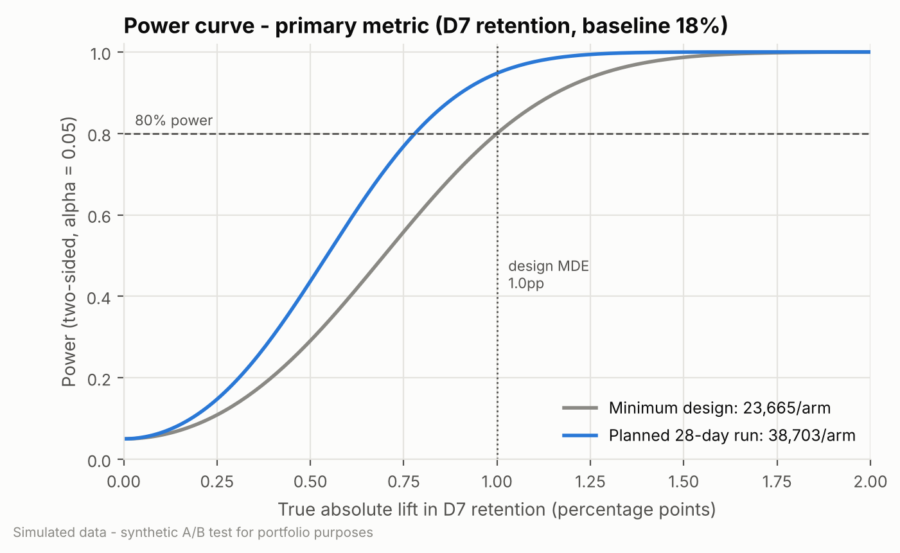

# Experiment Plan (Pre-registration): Short "Learn-by-Playing" Onboarding

> **SIMULATED DATA.** This is a portfolio project. The game, players and results are synthetic,
> generated by `src/simulate.py`. The process (pre-registration, then analysis, then readout) follows how a real product analytics team would work.

| | |
|---|---|
| **Experiment ID** | `onb_short_tutorial_v1` |
| **Owner** | Product Analytics (Player Lifecycle) |
| **Stakeholders** | Onboarding PM, Game Director, Monetisation PM, Client Engineering |
| **Status** | **Frozen.** Written and committed *before* any treatment-vs-control comparison (see git history) |
| **Plan date** | 2026-08-25 (simulated timeline) |
| **Enrolment** | 2026-09-01 to 2026-09-28 UTC (28 days) |
| **Follow-up** | 14 days after the last enrolment day; data cutoff **2026-10-13 00:00 UTC** |

---

## 1. Background

New-player retention is the biggest lever on lifetime value in our free-to-play puzzle game.
Funnel data shows the current **7-step forced tutorial** is where we lose the most players on day 0:
a large share of installs never finish it, and drop-off rises with every step.
Playtests suggest players want to "just play".

The treatment replaces the forced tutorial with a **3-step "learn by playing" onboarding**.
Mechanics are taught inside the first levels, and further guidance comes as *optional* tips.

**Known risk.** Step 6 of the current tutorial walks players through the **shop**. The new flow
drops it. Monetisation is worried that early purchase conversion will fall.

## 2. Hypothesis

* **H0:** The short onboarding does not change D7 retention: `p_T = p_C`.
* **H1:** The short onboarding changes D7 retention: `p_T != p_C`. The test is **two-sided**, because the change could plausibly hurt retention (less guidance) as well as help it.

Directional expectation (not tested one-sided): fewer forced steps → more players reach core
gameplay on day 0 → higher early engagement → higher D7 retention.

## 3. Metrics

All metrics are **per player**, computed from **calendar days since install in UTC** (day 0 = install day).
"First 7 days" means calendar days 0–6.

| Role | Metric | Definition | Type |
|---|---|---|---|
| **Primary** | **D7 retention** | 1 if the player has ≥1 session on calendar day 7 after install, else 0 | binary |
| Secondary | Tutorial completion | 1 if a `tutorial_complete` event exists (either flow), else 0 | binary |
| Secondary | Levels completed by D3 | count of distinct `level_complete` events on days 0–3 | count (skewed) |
| Secondary | D1 retention | 1 if ≥1 session on calendar day 1 | binary |
| Guardrail | Early purchase conversion | 1 if ≥1 purchase on days 0–6 | binary |
| Guardrail | Revenue per player (D7) | sum of gross `revenue_usd` on days 0–6 (0 for non-payers) | continuous, heavy-tailed |
| Guardrail | Crash rate | 1 if ≥1 crash on days 0–6 | binary |
| Guardrail | Avg session length | mean `session_length_sec` over the player's sessions on days 0–6 (players with ≥1 session) | continuous, heavy-tailed |
| Covariate | Day-0 sessions | number of sessions on install day | count |

A player counts as **Dn retained** only if their day-n window has fully elapsed before the data cutoff.

### 3.1 Guardrail thresholds ("unacceptable degradation")

These were agreed with stakeholders before launch. Each one is a business tolerance, not a statistical quantity.

| Guardrail | Unacceptable if treatment vs control is worse than | Rationale |
|---|---|---|
| Early purchase conversion | **−10% relative** | Early payers drive most first-month revenue; a 10% drop would not be offset by a 1pp retention gain in the LTV model |
| Revenue per player (D7) | **−10% relative** | Same tolerance as conversion |
| Crash rate (first 7 days) | **+10% relative** | Client team's standard tolerance for any release |
| Avg session length | **−5% relative** | Proxy for depth of engagement; small drops are expected (shorter tutorial session) |

**Guardrail evaluation rule.** We use the 95% CI, not only the p-value:

* **PASS**: the whole CI is on the acceptable side of the threshold (the "worse" bound does not cross it).
* **INCONCLUSIVE**: the point estimate is within tolerance, but the CI's worse bound crosses the threshold. We cannot rule out an unacceptable degradation.
* **FAIL**: the point estimate itself is beyond the threshold.

## 4. Design

| Item | Decision |
|---|---|
| Unit of randomisation | Player (install), deterministic hash of player ID at **first launch** |
| Unit of analysis | Player (same as randomisation, so no clustering correction is needed) |
| Allocation | 50 / 50 control : treatment |
| Control | Current 7-step forced tutorial |
| Treatment | 3-step learn-by-playing onboarding + optional tips |
| Exposure | Assignment is logged at first launch, and onboarding starts immediately, so **assignment = exposure** |
| Analysis population | **Intention-to-treat (ITT):** every eligible assigned player is analysed in their assigned arm, whether or not they finished onboarding |
| Interim looks | **None.** Fixed-horizon test, analysed once after the follow-up ends. No early stopping on the primary metric. |

### 4.1 Eligibility and exclusion rules (applied blind to variant)

1. **Enrolment window:** `install_ts` in `[2026-09-01, 2026-09-29)` UTC. Installs assigned after enrolment closed (for example, if the flag is switched off late) are excluded.
2. **Complete D7 window:** `install_date + 7 < cutoff_date`. Every enrolled player satisfies this by design (and has a complete D14 window too); the rule is stated as a guard.
3. **Valid assignment:** the player has assignment rows for exactly **one** variant. Duplicate rows for the same variant are collapsed to the earliest. Players logged in **both** arms are excluded and counted.
4. **Assignment after install:** players whose `assigned_ts < install_ts` (a logging or clock error) are excluded and counted.
5. **Bot-like activity:** players with **more than 50 sessions on any single calendar day** are excluded. This threshold is far above any plausible human pattern (historical p99.99 is around 10 sessions a day).
6. Exact-duplicate event rows (same player, timestamp, type and values) are removed before metrics are computed.

Exclusions are reported by arm. If any exclusion step removes players unevenly across arms (chi-square p < 0.001), we investigate before reading results.

## 5. Sample size and power

Computed with `src/power.py`, using the arcsine (Cohen's h) normal approximation, which matches `statsmodels` `NormalIndPower`.

**Choice of MDE: +1.0pp absolute (≈ 5.6% relative).**

* *Business:* the shorter flow carries a known monetisation risk and some engineering cost. Finance's LTV model puts break-even against a 5–10% early-revenue loss at about +1pp D7. Smaller lifts would not justify the risk.
* *Plausibility:* past onboarding tests in this genre moved D7 by roughly 0.5–2pp. A 1pp MDE is ambitious but realistic.
* *Run time:* the minimum sample for 1.0pp takes under 3 weeks of installs. We still run **28 days** so that we (a) cover four full weekly cycles (weekend installs behave differently), and (b) gain sensitivity for the guardrails, which are the binding constraint (see the second table).

<!-- BEGIN:power (generated by `python -m src.power --write-plan`) -->
| Input | Value |
|---|---|
| Significance level (two-sided) | alpha = 0.05 |
| Power | 80% |
| Baseline D7 retention | 18% |
| Design MDE | +1.0pp absolute (5.6% relative) |
| **Required sample size** | **23,665 per arm (47,330 total)** |
| Eligible installs per day (planning) | 2,850 x 97% eligibility |
| Minimum run time | 18 days |
| **Planned run time** | **28 days enrolment** (4 full weekly cycles) + 14 days follow-up |
| Expected sample at 28 days | ~38,703 per arm |
| MDE at planned sample | +0.78pp |
| Power for a 1.0pp lift at planned sample | 94.8% |

**MDE vs sample size (primary metric, 80% power, alpha 0.05):**

| MDE (abs, pp)   | MDE (rel, %)   | n per arm   | n total   | Days of enrolment   |
|:----------------|:---------------|:------------|:----------|:--------------------|
| 0.6             | 3.3            | 65,190      | 130,380   | 48                  |
| 0.8             | 4.4            | 36,823      | 73,646    | 27                  |
| 1.0             | 5.6            | 23,665      | 47,330    | 18                  |
| 1.2             | 6.7            | 16,501      | 33,002    | 12                  |
| 1.5             | 8.3            | 10,625      | 21,250    | 8                   |
| 2.0             | 11.1           | 6,036       | 12,072    | 5                   |

**Guardrail sensitivity at the planned sample (~38,703/arm):**

| Guardrail                              | Planning baseline   | MDE at planned n (rel)   | Unacceptable threshold (rel)   | Powered for threshold?   |
|:---------------------------------------|:--------------------|:-------------------------|:-------------------------------|:-------------------------|
| Purchase conversion (first 7 days)     | 2.5%                | 12.2%                    | -10%                           | no                       |
| Revenue per player (first 7 days, USD) | $0.20 (SD $2.50)    | 25.2%                    | -10%                           | no                       |
| Crash rate (first 7 days)              | 8.0%                | 6.9%                     | +10%                           | yes                      |
| Avg session length (sec, first 7 days) | 330s (SD 330s)      | 2.0%                     | -5%                            | yes                      |

<!-- END:power -->

**Implication.** The primary metric is well powered. The purchase and revenue guardrails are **not**
powered to detect a 10% drop, since revenue is far too heavy-tailed. This is why guardrails use the
CI-versus-threshold rule. An INCONCLUSIVE purchase or revenue guardrail is a likely outcome, and the decision rules
(Section 8) say in advance what we do in that case.

## 6. Statistical analysis plan

### 6.1 Validity checks (run first)
* **Sample-ratio mismatch (SRM):** chi-square goodness-of-fit of assignment counts against 50/50.
  Run (a) on all players assigned during enrolment and (b) on the final analysis cohort.
  **Alarm if p < 0.001.** An SRM halts the analysis until the cause is found; we do not interpret results under SRM.
* **Assignment QC** (`sql/01_assignment_qc.sql`): counts per variant, duplicate assignment rows, players in both arms, assignment before install, assignments outside the enrolment window.
* **Covariate balance:** platform, device tier, country tier, acquisition channel and day-0 sessions by arm. Report standardised mean differences (SMD); |SMD| > 0.1 is flagged.

### 6.2 Primary metric (confirmatory)
* Difference in proportions `p_T − p_C` with a **95% Wald CI** (unpooled SE); p-value from the **two-proportion z-test** (pooled SE).
* **Relative lift** `p_T / p_C − 1` with a 95% CI from the **delta method**.
* **Robustness:** percentile bootstrap CI (2,000 resamples, stratified by arm).
* **Variance reduction (pre-specified, precision analysis):** CUPED using day-0 sessions as the covariate, plus OLS regression adjustment (day-0 sessions + strictly pre-assignment covariates: platform, device, country, channel) with HC2 robust SEs. We report how much the CI narrows.
  *The unadjusted estimate stays the confirmatory one.* Day-0 sessions are measured after first launch, so they are not strictly pre-treatment. We use them only if the balance check shows no difference between arms.

### 6.3 Secondary metrics
* Binary metrics (tutorial completion, D1): two-proportion z-test and Wald CI, as for the primary.
* Levels by D3 (skewed count): **Welch t-test** on means, plus a bootstrap CI. **Mann–Whitney U** as a distributional sensitivity check.
* **Multiplicity:** **Holm** correction across the 3 secondary metrics (family-wise α = 0.05).

### 6.4 Guardrails
* Binary guardrails: as for the primary. Continuous guardrails: Welch t-test, delta-method relative CI, bootstrap CI, and Mann–Whitney as a sensitivity check.
* Each is judged against its threshold with the PASS / INCONCLUSIVE / FAIL rule in §3.1. We apply no p-value correction, because guardrails are judged on CIs and a stricter correction would only make it harder to detect harm.

### 6.5 Pre-specified segments (exploratory)
* **Platform** (iOS, Android), **device tier** (low, mid, high), **country tier** (T1, T2, T3), giving 8 segment-level D7 effects.
* Per segment: difference in proportions, 95% CI and p-value, with **Benjamini–Hochberg** FDR control (q = 0.05) across all 8.
* Per dimension: a heterogeneity test (Cochran's Q on the segment effects).
* **Segment results are exploratory.** They generate hypotheses for follow-ups and cannot overturn the primary decision.

### 6.6 Other planned analyses
* **Retention curves D0–D14** by arm, with 95% CIs.
* **Novelty check:** D7 effect by enrolment week (4 weekly cohorts), plus a heterogeneity test. A fading effect would suggest novelty or a learning effect.
* **Practical significance:** extra D7-retained players per 100k installs, and a rough value-versus-cost comparison of the retention gain against the early-revenue guardrail, with explicit assumptions.

## 7. Data pipeline
1. `sql/01_assignment_qc.sql`: assignment QC.
2. `sql/02_player_cohort.sql`: dedupe, eligibility, bot exclusion, giving the clean cohort.
3. `sql/03_metrics_per_player.sql`: one row per player with every metric.
4. `sql/04_segment_metrics.sql`: aggregates by variant × segment.
5. `src/analysis.py`: all statistics, tables and figures.

## 8. Decision rules (fixed in advance)

| # | Condition | Decision |
|---|---|---|
| 0 | SRM (p < 0.001) or a data-integrity failure | **No decision.** Investigate and re-run. |
| 1 | Primary significantly **positive** (95% CI > 0) **and** all guardrails **PASS** | **SHIP** to 100% |
| 2 | Primary significantly positive, no guardrail FAIL, but ≥1 guardrail **INCONCLUSIVE** | **SHIP WITH MITIGATION: staged rollout** (keep a 10% holdback to keep measuring the inconclusive guardrail) **plus a follow-up fix experiment** targeting it |
| 3 | Primary significantly positive but ≥1 guardrail **FAIL** | **ITERATE:** do not ship; fix the guardrail regression and re-test |
| 4 | Primary not significant, but ≥1 Holm-significant positive secondary and no guardrail FAIL | **ITERATE:** promising mechanism, insufficient retention impact |
| 5 | Primary significantly **negative**, or no significant improvement anywhere | **DON'T SHIP** |

Practical significance check: if rule 1 or 2 applies but the CI for the D7 lift is entirely below +0.5pp,
the team re-checks the LTV case before rolling out.

## 9. Risks and assumptions
* **SUTVA:** single-player game with no trading or co-op, so interference between arms is assumed negligible. Guild and social features unlock after the first week.
* **Novelty:** onboarding happens once per player, so classic novelty effects should be small. We check by enrolment week anyway.
* **Covariate timing:** day-0 sessions are measured after assignment (see §6.2).
* **Metric definitions:** UTC calendar days, not 24-hour windows or local time. A player who installs at 23:50 UTC can be "D1 retained" ten minutes later. The definition is identical in both arms, so it does not bias the comparison.
* **Short horizon:** D7 effects may not carry through to D30+ retention or LTV. Section 6.6 uses explicit assumptions to bridge the gap.
