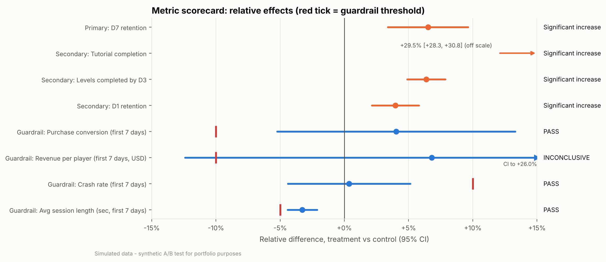
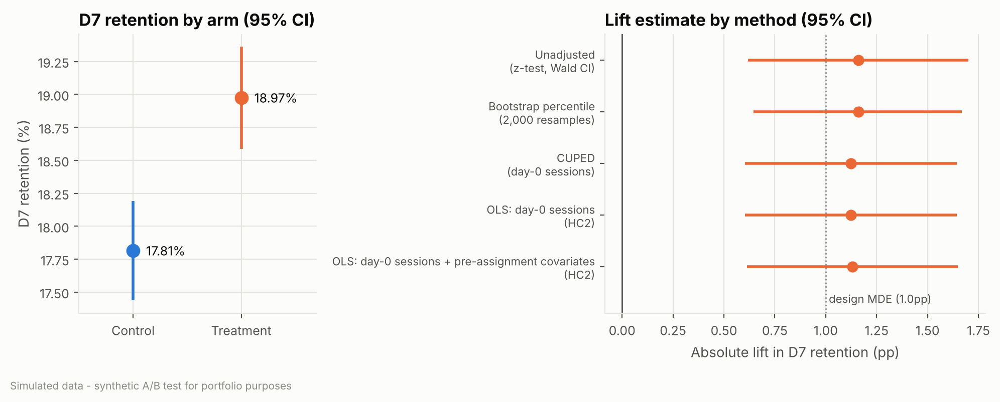
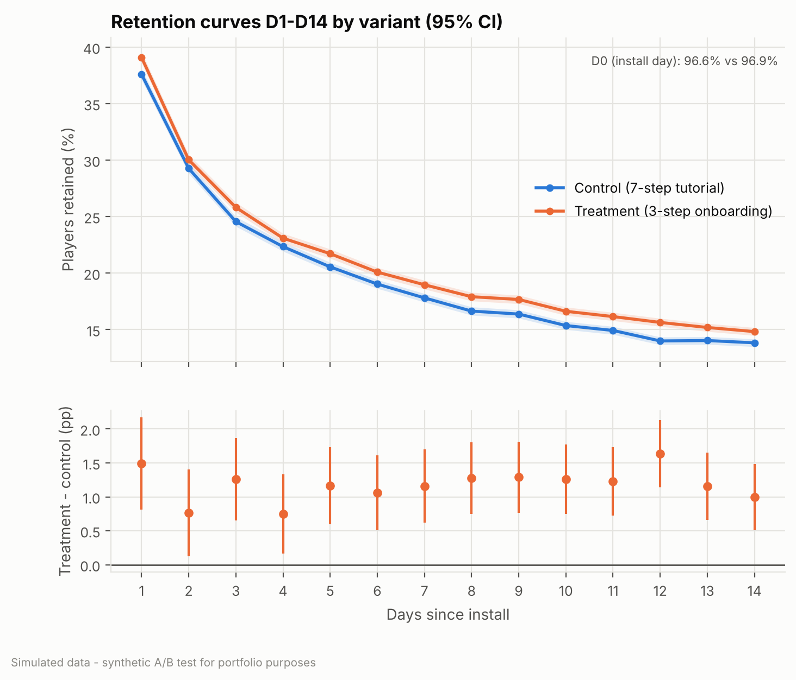
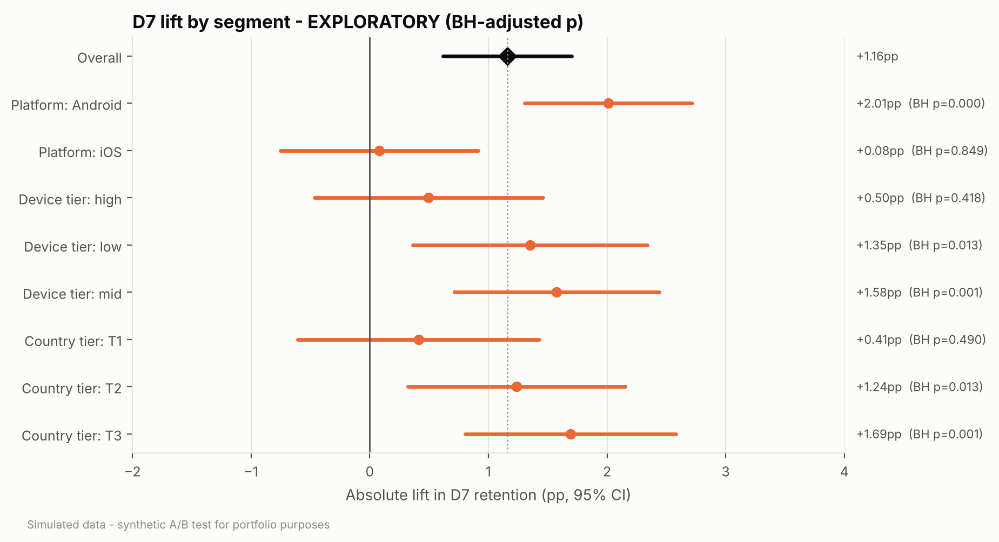
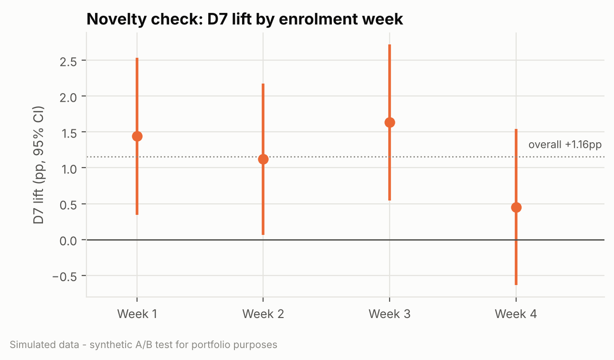

<!-- GENERATED FILE: rendered by `python -m src.report` from docs/templates/02_experiment_readout.template.md
     and outputs/tables/results.json. Do not edit by hand; every number comes from the analysis outputs. -->

# Experiment Readout: Short "Learn-by-Playing" Onboarding (`onb_short_tutorial_v1`)

> **SIMULATED DATA.** This is a portfolio project. The game, players and results are synthetic
> (`src/simulate.py`). It is written as a product analytics team would present a readout.

**Audience:** Onboarding PM, Game Director, Monetisation PM · **Analysis:** Product Analytics ·
**Pre-registration:** [01_experiment_plan.md](01_experiment_plan.md)

## TL;DR

**Recommendation: SHIP WITH MITIGATION (staged rollout + follow-up fix experiment)** (pre-registered decision rule 2).
The 3-step onboarding raises **D7 retention from 17.81% to 18.97% (+1.16pp, 95% CI +0.62pp to +1.70pp; p < 0.0001)**, about **1,160 extra retained players per 100k installs**.
Every guardrail passes except first-week revenue, whose wide CI (-12.4% to +26.0%) cannot rule out the −10% "unacceptable" drop. So we roll out in stages with a holdback, and in parallel test bringing back a shop prompt.

---

## 1. What we tested and why

* **Control:** the current 7-step forced tutorial, which includes a step that walks players through the shop.
* **Treatment:** a 3-step "learn by playing" onboarding with optional tips. The shop step is gone.
* **Why:** the forced tutorial was the biggest day-0 drop-off point. We expected that getting players into real levels sooner would improve early retention. The known risk was lower early monetisation, because players no longer see the shop.
* **Design:** player-level 50/50 randomisation at first launch. Installs from 2026-09-01 to 2026-09-28 were enrolled, with 14 days of follow-up. The analysis is intention-to-treat on **78,901 eligible players** (39,604 control / 39,297 treatment).
* The plan, metrics, thresholds and decision rules were committed before any treatment-vs-control comparison was run.

## 2. Can we trust the data?

| Check | Result |
|---|---|
| Sample-ratio mismatch (final cohort) | control share 50.19%, χ² p = 0.2744. **No SRM** (p = 0.2579 on all in-window assignments). |
| Covariate balance | max \|SMD\| = 0.014 across platform, device, country and channel. Day-0 sessions: 2.319 vs 2.323 (p = 0.6365). |
| Exclusions (pre-registered, blind to arm) | 5,393 late installs assigned after enrolment closed, 24 players logged in both arms, 27 assigned before install, 38 bot-like players (>50 sessions/day). None of these steps is unbalanced by arm. |
| De-duplication | 11,204 duplicate session rows and 32,320 duplicate progression events removed. |

| Population                               | Control   | Treatment   | Control share   | p-value   | Alarm (p < 0.001)   |
|:-----------------------------------------|:----------|:------------|:----------------|:----------|:--------------------|
| All players assigned in enrolment window | 39,654    | 39,336      | 50.20%          | 0.2579    | no                  |
| Final analysis cohort                    | 39,604    | 39,297      | 50.19%          | 0.2744    | no                  |
| Excluded: assigned_before_install        | 11        | 16          | 40.74%          | 0.3430    | no                  |
| Excluded: assigned_both_arms             | 14        | 10          | 58.33%          | 0.5413    | no                  |
| Excluded: bot_like_activity              | 25        | 13          | 65.79%          | 0.0730    | no                  |

## 3. Results scorecard

| Metric                                 | Role      | Control   | Treatment   | Abs diff   | Rel diff   | 95% CI (abs)         | 95% CI (rel)     | p-value   | Adj. p   | Verdict                  |
|:---------------------------------------|:----------|:----------|:------------|:-----------|:-----------|:---------------------|:-----------------|:----------|:---------|:-------------------------|
| D7 retention                           | Primary   | 17.81%    | 18.97%      | +1.16pp    | +6.5%      | [+0.62pp, +1.70pp]   | [+3.4%, +9.6%]   | < 0.0001  | < 0.0001 | **Significant increase** |
| Tutorial completion                    | Secondary | 59.74%    | 77.37%      | +17.63pp   | +29.5%     | [+17.00pp, +18.27pp] | [+28.3%, +30.8%] | < 0.0001  | < 0.0001 | **Significant increase** |
| Levels completed by D3                 | Secondary | 6.69      | 7.11        | +0.43      | +6.4%      | [+0.33, +0.52]       | [+4.9%, +7.9%]   | < 0.0001  | < 0.0001 | **Significant increase** |
| D1 retention                           | Secondary | 37.60%    | 39.09%      | +1.49pp    | +4.0%      | [+0.81pp, +2.17pp]   | [+2.1%, +5.8%]   | < 0.0001  | < 0.0001 | **Significant increase** |
| Purchase conversion (first 7 days)     | Guardrail | 2.35%     | 2.44%       | +0.09pp    | +4.0%      | [-0.12pp, +0.31pp]   | [-5.2%, +13.3%]  | 0.3843    | n/a      | **PASS**                 |
| Revenue per player (first 7 days, USD) | Guardrail | $0.188    | $0.200      | +0.013     | +6.8%      | [-0.022, +0.048]     | [-12.4%, +26.0%] | 0.4737    | n/a      | **INCONCLUSIVE**         |
| Crash rate (first 7 days)              | Guardrail | 7.95%     | 7.98%       | +0.03pp    | +0.4%      | [-0.35pp, +0.41pp]   | [-4.4%, +5.1%]   | 0.8804    | n/a      | **PASS**                 |
| Avg session length (sec, first 7 days) | Guardrail | 335.2s    | 324.2s      | -11.0s     | -3.3%      | [-14.9s, -7.1s]      | [-4.4%, -2.1%]   | < 0.0001  | n/a      | **PASS**                 |

*Primary: no correction (single pre-registered primary). Secondary: Holm-adjusted across the 3 secondaries.
Guardrails are judged by CI against threshold, not by p-value. Retention metrics use the z-test with a Wald CI;
count and continuous metrics use the Welch t-test. Relative CIs use the delta method.*

## 4. Results in detail

### 4.1 Primary: D7 retention, significant lift above the design MDE

D7 retention rose by **+1.16pp** (+6.5% relative; relative CI +3.4% to +9.6%).
The point estimate is above the pre-registered 1.0pp MDE, and the whole CI is above zero. Every robustness check agrees:

| Method                                                | Lift    | 95% CI             | CI width   | Width vs unadjusted   | p-value   |
|:------------------------------------------------------|:--------|:-------------------|:-----------|:----------------------|:----------|
| Unadjusted (z-test, Wald CI)                          | +1.16pp | [+0.62pp, +1.70pp] | 1.08pp     | +0.0%                 | < 0.0001  |
| Bootstrap percentile (2,000 resamples)                | +1.16pp | [+0.64pp, +1.67pp] | 1.02pp     | -5.4%                 | -         |
| CUPED (day-0 sessions)                                | +1.12pp | [+0.60pp, +1.64pp] | 1.04pp     | -3.7%                 | < 0.0001  |
| OLS: day-0 sessions (HC2)                             | +1.12pp | [+0.60pp, +1.64pp] | 1.04pp     | -3.7%                 | < 0.0001  |
| OLS: day-0 sessions + pre-assignment covariates (HC2) | +1.13pp | [+0.61pp, +1.65pp] | 1.04pp     | -4.2%                 | < 0.0001  |

* **Bootstrap** CI (+0.64pp to +1.67pp) matches the analytic CI.
* **CUPED** with day-0 sessions narrows the CI by only **3.7%**. Day-0 sessions correlate just 0.27 with a binary D7 outcome, which caps the variance reduction at 7.3%. Adding pre-assignment covariates in OLS gives 4.2%. For a continuous metric that tracks day-0 engagement more closely (levels by D3, correlation 0.66), CUPED narrows the CI by **24.7%** (`outputs/tables/cuped_by_metric.csv`). As pre-registered, the unadjusted estimate remains the confirmatory one.

The lift appears from D1 onwards and persists. The 95% CI of the daily difference excludes zero on 14 of 14 days, and the D14 gap is still +0.99pp (CI +0.50pp to +1.48pp):

### 4.2 Secondary metrics: all improved (Holm-adjusted)

* **Tutorial completion:** 59.74% → 77.37% (**+17.63pp**, adj. p < 0.0001). The mechanism works: a shorter flow is completed far more often.
* **Levels completed by D3:** 6.69 → 7.11 (+6.4%, adj. p < 0.0001; bootstrap CI +0.34 to +0.52; Mann–Whitney p < 0.0001). Players reach real gameplay sooner.
* **D1 retention:** 37.60% → 39.09% (+1.49pp, adj. p < 0.0001).

### 4.3 Guardrails against pre-registered thresholds

| Guardrail                              | Rel diff   | 95% CI (rel)     | Bootstrap CI (rel)   | Unacceptable if worse than   | Worse CI bound   | Mann-Whitney p   | Verdict          |
|:---------------------------------------|:-----------|:-----------------|:---------------------|:-----------------------------|:-----------------|:-----------------|:-----------------|
| Purchase conversion (first 7 days)     | +4.0%      | [-5.2%, +13.3%]  | [-5.1%, +13.8%]      | -10%                         | -5.2%            | -                | **PASS**         |
| Revenue per player (first 7 days, USD) | +6.8%      | [-12.4%, +26.0%] | [-9.9%, +27.4%]      | -10%                         | -12.4%           | 0.3802           | **INCONCLUSIVE** |
| Crash rate (first 7 days)              | +0.4%      | [-4.4%, +5.1%]   | [-4.4%, +5.0%]       | +10%                         | +5.1%            | -                | **PASS**         |
| Avg session length (sec, first 7 days) | -3.3%      | [-4.4%, -2.1%]   | [-4.4%, -2.1%]       | -5%                          | -4.4%            | < 0.0001         | **PASS**         |

* **Revenue per player (first 7 days): INCONCLUSIVE.** The point estimate is +6.8%, but revenue is so heavy-tailed that the CI runs from -12.4% to +26.0%. Its worse bound crosses the −10% threshold. This was expected: at the planned sample the test could only detect a 25.2% revenue change.
* **Purchase conversion: PASS, but read with care.** The point estimate is +0.09pp (+4.0%, p 0.3843), and the CI's lower bound (-5.2%) stays inside the −10% tolerance. However, the design could only detect about a 12.2% drop, and removing the shop step is a plausible mechanism for a small loss. A pass here is "no evidence of harm", not "evidence of no harm".
* **Avg session length: PASS.** Sessions are significantly shorter (-3.3%, CI -4.4% to -2.1%) but stay within the −5% tolerance. This fits the removal of one long forced-tutorial session.
* **Crash rate: PASS** (+0.4%, CI -4.4% to +5.1%).

## 5. Segments (EXPLORATORY) and novelty

> Pre-specified segments, Benjamini–Hochberg corrected. These results generate hypotheses and **do not change the decision**.

| Segment           | n (C / T)       | Control D7   | Treatment D7   | Lift    | 95% CI             | p        | BH-adj. p   | Heterogeneity p (Cochran's Q)   |
|:------------------|:----------------|:-------------|:---------------|:--------|:-------------------|:---------|:------------|:--------------------------------|
| Platform: Android | 21,888 / 21,493 | 16.03%       | 18.04%         | +2.01pp | [+1.30pp, +2.72pp] | < 0.0001 | < 0.0001    | 0.0005                          |
| Platform: iOS     | 17,716 / 17,804 | 20.02%       | 20.10%         | +0.08pp | [-0.75pp, +0.91pp] | 0.8493   | 0.8493      | 0.0005                          |
| Device tier: high | 13,355 / 13,325 | 19.93%       | 20.42%         | +0.50pp | [-0.47pp, +1.46pp] | 0.3136   | 0.4181      | 0.2385                          |
| Device tier: low  | 10,542 / 10,376 | 15.16%       | 16.51%         | +1.35pp | [+0.36pp, +2.34pp] | 0.0074   | 0.0127      | 0.2385                          |
| Device tier: mid  | 15,707 / 15,596 | 17.80%       | 19.38%         | +1.58pp | [+0.71pp, +2.44pp] | 0.0003   | 0.0009      | 0.2385                          |
| Country tier: T1  | 11,808 / 11,963 | 19.86%       | 20.27%         | +0.41pp | [-0.61pp, +1.43pp] | 0.4284   | 0.4896      | 0.1746                          |
| Country tier: T2  | 13,926 / 13,586 | 17.72%       | 18.96%         | +1.24pp | [+0.32pp, +2.15pp] | 0.0080   | 0.0127      | 0.1746                          |
| Country tier: T3  | 13,870 / 13,748 | 16.16%       | 17.86%         | +1.69pp | [+0.81pp, +2.58pp] | 0.0002   | 0.0007      | 0.1746                          |

* **Platform is the only dimension with significant heterogeneity** (Cochran's Q p = 0.0005). Android gains **+2.01pp** (CI +1.30pp to +2.72pp), while iOS shows essentially no lift (+0.08pp, CI -0.75pp to +0.91pp).
* By country tier, the lift is concentrated in T2/T3 (T1: +0.41pp, BH p 0.4896). By device, it is larger on low and mid tiers than on high-end devices (+0.50pp, BH p 0.4181). Neither dimension shows significant heterogeneity (p = 0.1746 and 0.2385).
* Interpretation (hypothesis): the old tutorial cost the most for players on slower devices and in lower-ARPU markets, while experienced, high-end-device players were already getting through it.

**Novelty check.** The D7 lift is consistent across the four enrolment weeks (heterogeneity p = 0.4582; linear trend -0.24pp per week, p = 0.3276). Week 4 is lower (+0.45pp, CI -0.64pp to +1.54pp), but within noise. Onboarding is a one-time experience for new installs, so a novelty effect was not expected.

| Enrolment week   | n (C / T)       | Lift    | 95% CI             | p      |
|:-----------------|:----------------|:--------|:-------------------|:-------|
| 1                | 9,749 / 9,643   | +1.44pp | [+0.35pp, +2.53pp] | 0.0098 |
| 2                | 10,190 / 10,173 | +1.12pp | [+0.07pp, +2.18pp] | 0.0374 |
| 3                | 9,850 / 9,595   | +1.63pp | [+0.55pp, +2.72pp] | 0.0033 |
| 4                | 9,815 / 9,886   | +0.45pp | [-0.64pp, +1.54pp] | 0.4150 |

## 6. Practical significance: what is the lift worth?

| Item (per 100k installs)                               | Central                | Range (95% CI)                              |
|:-------------------------------------------------------|:-----------------------|:--------------------------------------------|
| Extra D7-retained players                              | 1,160                  | 619 to 1,700                                |
| Value of extra retention (A1, A2)                      | $2,796                 | $1,492 to $4,099                            |
| Observed change in first-week revenue                  | $1,278                 | -$2,219 to $4,775                           |
| 180-day revenue at risk from early-revenue change (A3) | $0 (upside not banked) | worst case $4,437                           |
| **Net (value - revenue at risk)**                      | **$2,796**             | pessimistic (low gain, worst cost): -$2,945 |

**Assumptions (explicit and adjustable):**

* **A1.** Value of an extra D7-retained player = the observed difference in day 7–34 revenue between D7-retained and non-retained **control** players ($1.14 vs $0.17; 11,155 control players with a complete day-34 window).
* **A2.** 180-day value ≈ 2.5× the day 7–34 value, giving **$2.41 per extra retained player**.
* **A3.** Each $1 of lost first-week revenue costs about $2.0 over 180 days (early payers are disproportionately repeat payers).
* **A4.** The observed first-week revenue change is not significant. A positive point estimate is **not** counted as a gain; only downside risk is counted.
* Gross revenue (before store fees) only. No ad revenue, no UA-cost effects, and no virality.

**Reading it:** the central case is positive ($2,796 per 100k installs, from retention alone), but small in absolute terms.
A sustained **first-week revenue drop of 7.5% or more would wipe it out**, and the revenue CI cannot rule that out. In the pessimistic corner (low end of the lift, worst end of revenue) the change loses money (-$2,945).
That is why the decision depends on the revenue guardrail rather than on the primary metric. A caveat on A1: the extra retained players are concentrated on Android and lower-tier markets, where spend is lower. So A1 probably *overstates* their value.

## 7. Recommendation

**SHIP WITH MITIGATION (staged rollout + follow-up fix experiment).** This follows pre-registered **rule 2**: primary significantly positive, no guardrail FAIL, at least one guardrail INCONCLUSIVE (revenue).

1. **Staged rollout:** ship the short onboarding to 90% of new installs and keep a **10% holdback on the old tutorial for 6 weeks**. The holdback keeps a concurrent control so we can go on measuring revenue (pooled with this test) and extend the value window to D30+. Roll back if the cumulative first-week revenue CI moves wholly below −10%.
2. **Follow-up fix experiment** (runs inside the 90%): put back a lightweight, optional **shop prompt after level 5** (a "starter pack" tip). It targets the one mechanism that could plausibly cost revenue, without bringing back the forced flow.
3. **iOS / T1:** no action yet. The flat iOS result is exploratory. Validate it in the holdback before considering a platform-specific flow.

## 8. Limitations

* **Synthetic data.** Every number here comes from a simulation with known built-in effects. Real behaviour is messier: time-zone effects, store-featuring shocks, and seasonality.
* **Short horizon.** We measure D7/D14 retention and first-week revenue. LTV is extrapolated with assumptions A1–A3, so long-term retention could converge between the arms.
* **Guardrail power.** Purchase conversion and revenue are underpowered for their thresholds (minimum detectable change ≈ 12.2% and 25.2%). Absence of evidence is not evidence of absence.
* **Multiple comparisons.** Holm controls the secondaries and BH the segments. Guardrails, curves and the novelty table are uncorrected and should be read as descriptive.
* **Segment findings** are exploratory. Platform heterogeneity could be confounded with country tier, since iOS skews towards T1.
* **Novelty:** onboarding is seen once per player, but we only observe 4 enrolment weeks, so seasonal changes in install mix could hide a slow drift.
* **External validity:** enrolment ran over a single month with the current UA mix. A shift towards paid social or T1 traffic would change the average effect, given the heterogeneity.
* **SUTVA / interference:** we assume none, since the game is single-player in week 1. Social features (guilds, gifting) could leak treatment effects later.
* **Metric definitions:** retention uses UTC calendar days, so a player who installs late in the day gets an easier D1. Average session length is conditional on having at least one session, which is a mild selection risk. Day-0 sessions (the CUPED covariate) are measured after randomisation; balance holds, but it is not a true pre-period variable.
* **Revenue** is gross, excludes refunds, and ignores ad monetisation.

## 9. Next steps

1. Launch the staged rollout with the 10% holdback, and pre-register the holdback readout (first-week revenue and D30 retention) now.
2. Run the shop-prompt follow-up test. Primary metric: first-week purchase conversion. Guardrail: D7 retention must stay within −0.5pp of the short-onboarding arm.
3. Measure D30/D60 retention and revenue in the holdback to replace assumptions A1–A3 with observed values.
4. Investigate the iOS/T1 null result with a targeted analysis (tutorial completion and skip rates by platform) before considering any platform-specific onboarding.
5. Add the onboarding change to the long-term holdout so its effect can be tracked against future UA-mix changes.

---

*Reproduce with `make all`. Tables: `outputs/tables/`. Figures: `outputs/figures/`. Methods: `src/stats_utils.py`, `src/analysis.py`.*
